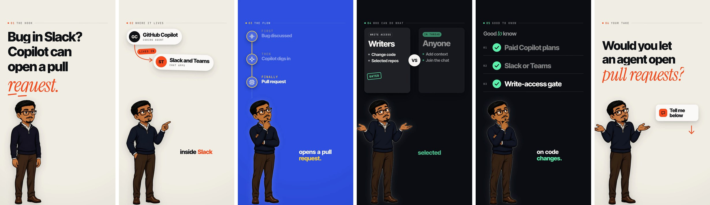

# Byte Sized AI News (Newsletter-to-Video Pipeline)

[](https://github.com/mattthomas7641/newsletter-video-pipeline/actions/workflows/tests.yml)
[](LICENSE)


An unattended daily pipeline that turns the [TLDR](https://tldr.tech) newsletters into
40–45 second vertical (1080×1920) tech-news explainers and uploads them to YouTube Shorts.

**Live channel:** [Byte Sized AI News](https://www.youtube.com/@byte-sized-ai-news-11)


*Frames from one published Short in the avatar-explainer (`avx`) format, in order: the hook, a diagram, a timeline, a
comparison, a checklist and the closing question.*

## At a glance

| | |
|---|---|
| **Runs** | Every day at noon ET as a Cloud Run job started by Cloud Scheduler. No laptop involved ([docs/cloud.md](docs/cloud.md)). |
| **Output** | Up to 10 Shorts a day. Videos that fail the fact check or the editor are dropped: on 2026-11-11 it posted 7 and dropped 12 drafts in 33 minutes. |
| **Cost** | About $0.14 to $0.22 of Claude usage per finished video, plus an estimated $0.35 a day for Cloud Run ([docs/cost.md](docs/cost.md)). |
| **Guardrails** | A spending cap and a deadline on every run, a fact check, a duplicate-upload guard, least-privilege cloud accounts, and a phone alert after every run. |
| **Tests** | 700 tests that run offline, in CI on every push to `main` and every pull request. |

## How it works

```
tldr.tech (4 editions) ──▶ scrape ──▶ Jev screens ──▶ Claude writes ──▶ voice each line ──▶ HyperFrames ──▶ MP4s ──▶ YouTube
   tech · ai ·              ~40–50     in scope? how     N scripts:        (cloned voice via   render                  Shorts
   marketing · founders     stories    newsworthy?       hook, beats,      Voicebox, or Kokoro)
                                       (optional)        cards, outro
```

1. **Scrape** the day's four TLDR editions (public pages, no login).
2. **Select.** Remove duplicates and stories already covered, then have Jev, a decision model from TypeSafe AI, score
   what is left so Claude only sees a shortlist ([docs/story-selection.md](docs/story-selection.md)).
3. **Write.** Claude Sonnet 5.5 picks the most interesting stories and writes each script with its title, caption and
   hashtags. Without an API key, a rule-based writer takes over.
4. **Check.** For the explainer and avx formats, every spoken line must quote the story and a separate fact check
   judges every claim. A video that fails is dropped and replaced ([docs/accuracy.md](docs/accuracy.md)).
5. **Voice.** Each script is turned into speech with an open or cloned voice, and captions are timed to the audio
   (average error 0.21 s in the avx format).
6. **Render.** Each video is an HTML composition rendered with [HyperFrames](https://github.com/heygen-com/hyperframes).
7. **Upload** to YouTube. Each upload is recorded as it succeeds, so a re-run never posts twice.

The code for each step is in `newsletter_video/`: `scraper.py`, `script_writer.py`, `factcheck.py`, `tts.py`,
`video_builder.py` and `youtube_upload.py`.

## Quick start

Requirements: [conda](https://docs.conda.io) (for Python 3.11 with ffmpeg) and Node.js (HyperFrames renders through
`npx`). No API keys are needed for a first run: the rule-based writer and the open Kokoro voice are the defaults.

```bash
git clone https://github.com/mattthomas7641/newsletter-video-pipeline.git
cd newsletter-video-pipeline
conda create -p ./venv python=3.11 ffmpeg -c conda-forge       # Python env with ffmpeg
./venv/bin/python -m pip install -r requirements.txt
./venv/bin/python -m newsletter_video.run_pipeline             # today's videos
./venv/bin/python -m newsletter_video.run_pipeline 2026-09-22  # a specific date
```

Output lands in `output/YYYY-MM-DD/01_<title-slug>.mp4`, `02_…`, each with a `.json` holding its title, description,
tags, the stories it covered and its full script. Running again for the same date resumes: only the videos still
missing are made, numbered after the existing ones. Logs go to `pipeline.log`.

## Configuration

Copy `.env.example` to `.env`. Everything is optional; these are the settings most people change first:

| Setting | What it does |
|---|---|
| `ANTHROPIC_API_KEY` | Claude writes the scripts (much more engaging than the rule-based fallback) |
| `TYPESAFE_API_KEY` | Jev screens and ranks stories before Claude sees them |
| `VIDEOS_PER_DAY` | Videos per run (default 3) |
| `VIDEO_STYLE` | `explainer` (default), a clean animated explainer; `avatar`, a narrator over gameplay footage; or `avx`, a narrator with one motion graphic per beat (what the cloud job runs) |
| `TTS_PROVIDER` | `kokoro` (default), `voicebox` (local cloned voice), `elevenlabs` (cloud cloned voice) or `say` (macOS) |
| `YOUTUBE_UPLOAD` | `1` uploads each day's videos after rendering |

The full list is in [docs/configuration.md](docs/configuration.md). Everything can also be set from a local control
panel (`./ui.sh`, see [docs/control-panel.md](docs/control-panel.md)).

## Documentation

| Topic | What's in it |
|---|---|
| [Running in the cloud](docs/cloud.md) | The Cloud Run job, Cloud Scheduler, service accounts and secrets |
| [Running on a schedule](docs/scheduling.md) | The `launchd` job on a Mac, and approval mode (plan first, render on request) |
| [Story selection](docs/story-selection.md) | How Jev scores scope, newsworthiness and importance, with the 595-story measurement |
| [Accuracy](docs/accuracy.md) | Evidence quotes, the independent fact check, refill, and what the editor may drop |
| [Cost](docs/cost.md) | Measured cost per video, what raised or lowered it, and the budget guards |
| [Failure handling](docs/failure-handling.md) | What happens for each failure, notifications, and resuming a run |
| [Video styles](docs/video-styles.md) | The explainer and avatar looks, quality gates, and the style library |
| [Customizing](docs/customizing.md) | The look, the narrator character, gameplay background and custom voices |
| [Control panel](docs/control-panel.md) | The local web panel for the daily lineup, design lab and settings |
| [Uploading to YouTube](docs/youtube-upload.md) | One-time OAuth setup, privacy and publishing options |
| [A second channel](docs/second-channel.md) | Remaking the first channel's best videos with another narrator, with no Claude calls |
| [Changelog](CHANGELOG.md) | What changed recently |

## Tests

```bash
./venv/bin/python -m pytest tests
```

The suite runs offline: no paid API, no uploads, no real renders.

## Content rights

You supply the narrator image, the voice and any gameplay background, and you are responsible for having the right to
use each of them before posting publicly. Clone your own voice or one you have permission to use. The default Kokoro
voice is an open model and needs no reference audio.

## License

[MIT](LICENSE)
