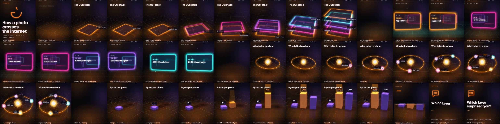

# ByteSize News (Newsletter-to-Video Pipeline)

[](https://github.com/mattthomas7641/newsletter-video-pipeline/actions/workflows/tests.yml)
[](LICENSE)


An unattended daily pipeline that turns the [TLDR](https://tldr.tech) newsletters into
40–45 second vertical (1080×1920) tech-news explainers and uploads them to YouTube Shorts.

**Live channel:** [Byte Sized AI News](https://www.youtube.com/@byte-sized-ai-news-11)


*Frames from one rendered Short, in order: the hook, three animated diagrams, a chart and the closing question.*

## At a glance

| | |
|---|---|
| **Runs** | Cloud Scheduler starts a Cloud Run job at 12:00 noon ET. No laptop involved ([docs/cloud.md](docs/cloud.md)). |
| **Output** | Up to 10 Shorts a day. A fact check and an editor pass drop any video that fails them, so a day can finish with fewer: on 2026-11-11 it posted 7, dropped 12 drafts, and took 33 minutes. |
| **Cost** | Claude about $0.14 to $0.22 per finished video depending on the writer prompt, plus about $0.35 a day for Cloud Run (an estimate, not yet seen on a bill). Details in [docs/cost.md](docs/cost.md). |
| **Guardrails** | A hard per-run Claude budget and deadline, a fact check on every explainer and avx script, an editor pass on avx scripts, a duplicate-upload guard, least-privilege service accounts, secrets in Secret Manager, a private bucket with a 7-day lifecycle, budget alerts, and a phone alert after every run. |
| **Tests** | 700 tests, including an offline fault-injection suite (a fake voice server that wedges, stubbed Claude and YouTube clients, stubbed renders). CI runs them on every push to `main` and every pull request. |

## How it works

```
tldr.tech (4 editions) ──▶ scrape ──▶ Jev screens ──▶ Claude writes ──▶ voice each line ──▶ HyperFrames ──▶ MP4s ──▶ YouTube
   tech · ai ·              ~40–50     in scope? how     N scripts:        (cloned voice via   render                  Shorts
   marketing · founders     stories    newsworthy?       hook, beats,      Voicebox, or Kokoro)
                                       (optional)        cards, outro
```

1. **Scrape** (`scraper.py`): reads `tldr.tech/{edition}/{date}` (public, no login) for the configured editions.
2. **Select** (`script_writer.py`): dedupes stories across editions, skips anything covered on an earlier day, and has
   Jev, a decision model from TypeSafe AI, screen and rank the rest so Claude only sees the shortlist
   ([docs/story-selection.md](docs/story-selection.md)).
3. **Write** (`script_writer.py`, `explainer_writer.py`, `avx_writer.py`): Claude Sonnet 5.5 picks the most
   interesting stories, combines related ones, and writes each script with its title, caption and hashtags. Without
   an API key, a rule-based writer takes over.
4. **Check** (`factcheck.py`): every spoken line must quote the story verbatim, an independent fact check judges every
   claim, and dropped videos are replaced from unused stories. On by default for the explainer and avx formats
   ([docs/accuracy.md](docs/accuracy.md)).
5. **Voice** (`tts.py`): the avx format voices each line as its own clip, so cards and captions start exactly on
   sentence boundaries (average caption error 0.21 s, down from 0.70 s when timing was estimated across the whole
   narration). The other formats voice the whole script and align words with Whisper when it is installed.
6. **Render** (`video_builder.py`, `explainer_builder.py`, `avx_builder.py`): times every card, caption and highlight
   to the audio and renders an HTML
   composition with [HyperFrames](https://github.com/heygen-com/hyperframes).
7. **Upload** (`youtube_upload.py`): each upload is recorded the moment it succeeds, so re-runs never post twice.

## Quick start

Requirements: [conda](https://docs.conda.io) (for Python 3.11 with ffmpeg) and Node.js (HyperFrames renders through
`npx`). No API keys are needed for a first run: the rule-based writer and the open Kokoro voice are the defaults.

```bash
git clone https://github.com/mattthomas7641/newsletter-video-pipeline.git
cd newsletter-video-pipeline
conda create -p ./venv python=3.11 ffmpeg -c conda-forge       # Python env with ffmpeg
./venv/bin/python -m pip install -r requirements.txt
./venv/bin/python -m newsletter_video.run_pipeline             # today's videos
./venv/bin/python -m newsletter_video.run_pipeline 2026-09-22  # a specific date
```

Output lands in `output/YYYY-MM-DD/01_<title-slug>.mp4`, `02_…`, each with a `.json` holding its title, description,
tags, the stories it covered and its full script. Running again for the same date resumes: only the videos still
missing are made, numbered after the existing ones. Logs go to `pipeline.log`.

## Configuration

Copy `.env.example` to `.env`. Everything is optional; these are the settings most people change first:

| Setting | What it does |
|---|---|
| `ANTHROPIC_API_KEY` | Claude writes the scripts (much more engaging than the rule-based fallback) |
| `TYPESAFE_API_KEY` | Jev screens and ranks stories before Claude sees them |
| `VIDEOS_PER_DAY` | Videos per run (default 3) |
| `VIDEO_STYLE` | `explainer` (default), a clean animated explainer; `avatar`, a narrator over gameplay footage; or `avx`, a narrator with one motion graphic per beat (what the cloud job runs) |
| `TTS_PROVIDER` | `kokoro` (default), `voicebox` (local cloned voice), `elevenlabs` (cloud cloned voice) or `say` (macOS) |
| `YOUTUBE_UPLOAD` | `1` uploads each day's videos after rendering |

The full list is in [docs/configuration.md](docs/configuration.md). Everything can also be set from a local control
panel (`./ui.sh`, see [docs/control-panel.md](docs/control-panel.md)).

## Documentation

| Topic | What's in it |
|---|---|
| [Running in the cloud](docs/cloud.md) | The Cloud Run job, Cloud Scheduler, service accounts and secrets |
| [Running on a schedule](docs/scheduling.md) | The `launchd` job on a Mac, and approval mode (plan first, render on request) |
| [Story selection](docs/story-selection.md) | How Jev scores scope, newsworthiness and importance, with the 595-story measurement |
| [Accuracy](docs/accuracy.md) | Evidence quotes, the independent fact check, refill, and what the editor may drop |
| [Cost](docs/cost.md) | Measured cost per video, what raised or lowered it, and the budget guards |
| [Failure handling](docs/failure-handling.md) | What happens for each failure, notifications, and resuming a run |
| [Video styles](docs/video-styles.md) | The explainer and avatar looks, quality gates, and the style library |
| [Customizing](docs/customizing.md) | The look, the narrator character, gameplay background and custom voices |
| [Control panel](docs/control-panel.md) | The local web panel for the daily lineup, design lab and settings |
| [Uploading to YouTube](docs/youtube-upload.md) | One-time OAuth setup, privacy and publishing options |
| [A second channel](docs/second-channel.md) | Remaking the first channel's best videos with another narrator, with no Claude calls |
| [Changelog](CHANGELOG.md) | What changed recently |

## Tests

```bash
./venv/bin/python -m pytest tests
```

The suite runs offline: no paid API, no uploads, no real renders.

## Content rights

You supply the narrator image, the voice and any gameplay background, and you are responsible for having the right to
use each of them before posting publicly. Clone your own voice or one you have permission to use. The default Kokoro
voice is an open model and needs no reference audio.

## License

[MIT](LICENSE)
